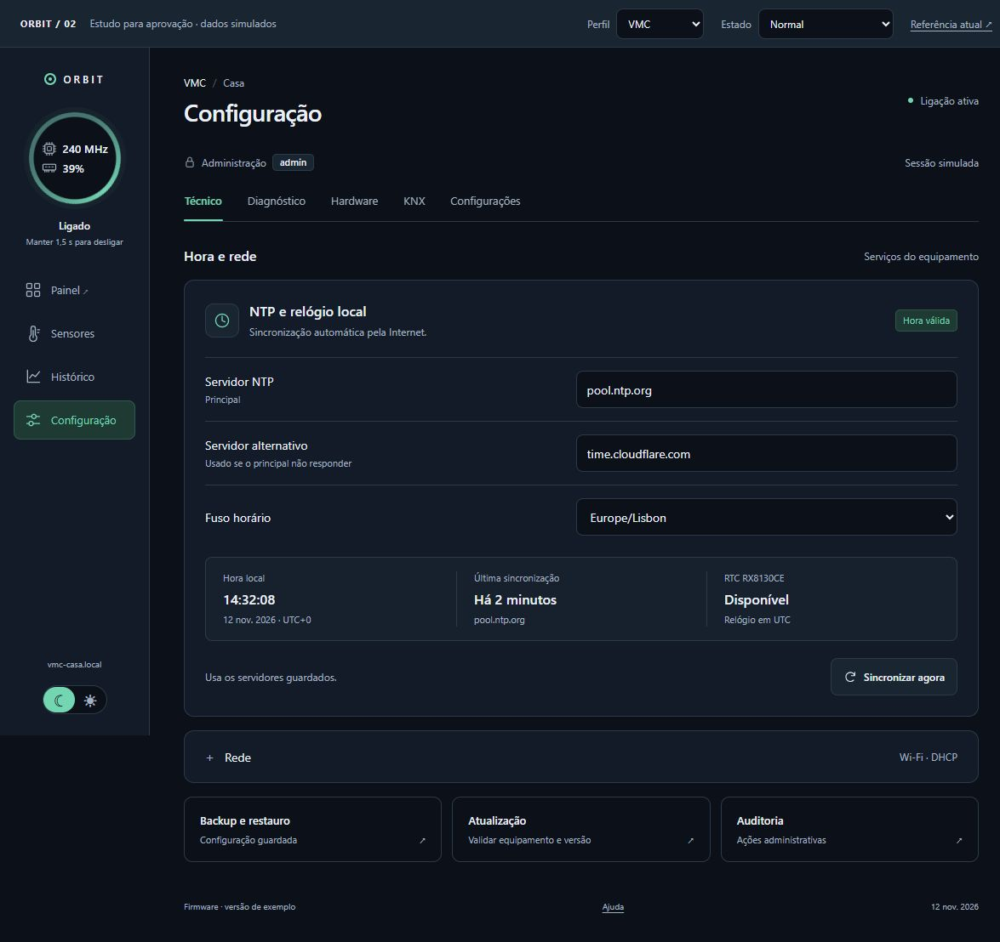

# Orbit / 02 — revisão e proposta

**Estado: proposta para aprovação.** 12 de novembro de 2026. Não altera os firmwares nem a interface principal do Design. Não instala nada nos equipamentos.

[Abrir mockup](index.html) · [Referência atual](../../../orbit.html)

## Resultado

A base Orbit pode ser mantida. As melhorias com maior impacto são tornar o comando circular legível no telemóvel, mostrar sempre o resultado dos comandos, eliminar diferenças de navegação e fazer os componentes herdar a mesma paleta nos dois temas. A configuração beneficia de uma hierarquia mais discreta e de uma indicação clara de alterações por guardar.

O estudo usa a análise **Linear** da biblioteca **Awesome DESIGN.md**: superfícies discretas, tipografia hierarquizada, bordas finas, espaçamento regular e destaque reservado às ações. É uma referência estática da biblioteca; não se afirma que reproduz a interface atual da Linear. Não se copiam marca, fonte proprietária, cor violeta, grandes títulos de marketing ou a restrição a tema escuro.

## Fontes verificadas

Foi atualizado e lido o `origin/main` de cada repositório. A comparação entre equipamentos é de código e contratos de interface; a inspeção no navegador incidiu no Design e no mockup. Não equivale a ensaio nos equipamentos.

| Repositório | Main observado |
|---|---|
| Design | `f81f008f2ceb6293f1a24f239501d1e68ba70a53` |
| VMC | `49fe8f8ba32e5326667a15c054bebb91b2cf6367` |
| LusoSol | `527b699064a5ded0f5eeb27bb5060744d0594fa7` |
| Sensores | `42846bd86119ada714590072d2196c990e61af8e` |
| Moxa | `a69ed222b9d16e1489f1ab340504cb3a13bbe1e0` |

As alterações locais existentes na VMC ficaram intactas. Os cartões de energia mais recentes do LusoSol foram considerados parte da interface a preservar.

## Problemas e melhorias

### 1. Prioridade alta — feedback de comando invisível no telemóvel

Em `orbit-controls.css:52`, uma mensagem não vazia é recortada para 1 × 1 px no ecrã pequeno. Continua disponível para um leitor de ecrã, mas uma pessoa a olhar para a página não vê a recusa ou a espera de confirmação. O mesmo padrão aparece no LusoSol e nos sensores.

**Proposta:** mensagem visível junto ao comando e mensagem contextual no conteúdo. Manter o último estado confirmado quando o pedido falha. O mockup permite selecionar «Comando recusado» e ensaiar a pressão de 1,5 s.

Evidência: [Design, linha 52](https://github.com/bratuga/design/blob/f81f008f2ceb6293f1a24f239501d1e68ba70a53/orbit-controls.css#L52), [LusoSol, linha 87](https://github.com/bratuga/iot-lusol/blob/527b699064a5ded0f5eeb27bb5060744d0594fa7/include/WebUi.h#L87), [sensores, linha 71](https://github.com/bratuga/iot-sensor-device/blob/42846bd86119ada714590072d2196c990e61af8e/include/WebUi.h#L71).

### 2. Prioridade alta — demasiados controlos na barra inferior

O círculo passa a 46 px e os indicadores a 8 px. As colunas automáticas incluem páginas, ligações do laboratório, comando e tema. A inspeção a 390 px confirmou a dificuldade de leitura. Na VMC existem ainda mais destinos do que no laboratório.

**Proposta significativa:** reservar a barra inferior para até quatro páginas; colocar o círculo de 76 px e o tema no topo. No computador, manter o círculo na barra lateral. Não acrescentar a antiga curva decorativa. Ajuda continua pública, no rodapé. Informação pública de «Status» deve continuar no Painel; não deve ficar escondida atrás de autenticação por passar a chamar-se diagnóstico.

Evidência: [Design, linhas 61–68](https://github.com/bratuga/design/blob/f81f008f2ceb6293f1a24f239501d1e68ba70a53/orbit-controls.css#L61), [navegação VMC](https://github.com/bratuga/iot-vmc-controler/blob/49fe8f8ba32e5326667a15c054bebb91b2cf6367/web/index.html#L129).

### 3. Prioridade média — cores documentadas e cores efetivas divergem

O Design documenta `#61d5b0` / `#18755f`, mas o laboratório usa `#77d7ba` / `#19735b`. Há ainda substituições sucessivas de tokens nos sensores. Separadamente, `orbit-actions.css` define cores locais com valores escuros de recurso; no tema claro do laboratório, o fundo de uma ação foi observado como `rgb(32,48,60)`, enquanto o painel era branco.

**Proposta:** uma tabela única de cores por tema, herdada por campos, botões, navegação e estados. Reservar verde para destaque/normal, âmbar para aviso e vermelho para falha; conservar as cores semânticas das séries e dos cartões operacionais.

Evidência: [tokens do laboratório](https://github.com/bratuga/design/blob/f81f008f2ceb6293f1a24f239501d1e68ba70a53/orbit-lab.css#L2), [substituição nas ações](https://github.com/bratuga/design/blob/f81f008f2ceb6293f1a24f239501d1e68ba70a53/orbit-actions.css#L2), [camadas nos sensores](https://github.com/bratuga/iot-sensor-device/blob/42846bd86119ada714590072d2196c990e61af8e/include/WebUi.h#L103).

### 4. Prioridade média — os mesmos destinos têm nomes e posições diferentes

VMC usa «Gráficos»; sensores usam «Histórico»; LusoSol apresenta «Sistema», «Hardware» e «Solar» na navegação principal. No Moxa, Painel e Sensores apontam ambos a `/`. Uniformizar apenas o aspeto não resolve estas diferenças.

**Proposta significativa:** Painel, Sensores, Histórico e Configuração, apenas onde existirem capacidades distintas. Consolidar a administração nos cinco grupos acordados. No Moxa, não inventar histórico nem duplicar destinos: a futura integração deve escolher um único acesso aos medidores ou separar efetivamente as vistas existentes.

Evidência: [LusoSol](https://github.com/bratuga/iot-lusol/blob/527b699064a5ded0f5eeb27bb5060744d0594fa7/include/WebUi.h#L168), [sensores](https://github.com/bratuga/iot-sensor-device/blob/42846bd86119ada714590072d2196c990e61af8e/include/WebUi.h#L121), [Moxa](https://github.com/bratuga/iot-moxa-router/blob/a69ed222b9d16e1489f1ab340504cb3a13bbe1e0/moxa-meter-web/static/index.html#L4).

### 5. Prioridade média — navegar não atualiza o endereço no laboratório

Os botões Painel/Configuração só alternam elementos ocultos. Não permitem abrir um separador por endereço nem regressar a ele através do botão Voltar. Os separadores internos já têm comportamento de teclado; esse trabalho deve ser preservado.

**Proposta:** endereços estáveis para páginas e secções, indicação de página atual e preservação do rascunho ao navegar. O mockup demonstra Voltar/Avançar, ligação direta e retorno ao formulário sem perder as alterações.

Evidência: [navegação Orbit](https://github.com/bratuga/design/blob/f81f008f2ceb6293f1a24f239501d1e68ba70a53/orbit-lab.js#L6), [testbench](https://github.com/bratuga/design/blob/f81f008f2ceb6293f1a24f239501d1e68ba70a53/app.js#L6).

### 6. Prioridade média — os exemplos não demonstram todos os estados dos gráficos

No laboratório, 24 h/7 dias altera apenas o texto e a seleção; a curva mantém-se igual. É uma limitação da demonstração, não uma conclusão sobre os históricos dos firmwares.

**Proposta:** o exemplo deve mudar série, escala temporal e tabela em conjunto, mostrar intervalos sem dados e distinguir valores antigos de leituras atuais. O mockup demonstra os dois períodos e uma tabela acessível, sem introduzir uma biblioteca de gráficos nos ESP32.

Evidência: [seletor de período](https://github.com/bratuga/design/blob/f81f008f2ceb6293f1a24f239501d1e68ba70a53/orbit-lab.js#L13).

### 7. Prioridade média — três experiências sem uma entrada canónica clara

O `index.html` é o testbench ModernUX, `iot.html` é um simulador de displays e `orbit.html` é a referência IoT mais recente. O tema usa três convenções distintas; o testbench e o IoT Lab não persistem a escolha como o Orbit.

**Proposta para uma fase posterior:** entrada «Orbit / componentes» como referência aprovada; experiências anteriores identificadas como laboratório. Separar componentes Web de padrões de display. Documentar versão, capacidades e estados esperados de cada componente. Evitar transformar uma mudança estética num framework adicional ou numa migração de firmware.

Evidência: [README](https://github.com/bratuga/design/blob/f81f008f2ceb6293f1a24f239501d1e68ba70a53/README.md), [tema do testbench](https://github.com/bratuga/design/blob/f81f008f2ceb6293f1a24f239501d1e68ba70a53/app.js#L12), [IoT Lab](https://github.com/bratuga/design/blob/f81f008f2ceb6293f1a24f239501d1e68ba70a53/iot.js).

### 8. Prioridade média — risco de apresentar recursos antigos após atualização

O service worker do testbench usa cache-first e uma chave fixa `modernux-test-v2`. Sem mudar a chave ou revalidar os recursos, uma instalação anterior pode continuar a apresentar CSS/JS antigos. O conjunto pré-carregado também não inclui o Orbit. Este é um risco identificado no código; não foi simulada uma atualização entre duas versões instaladas.

**Proposta:** versionar o pacote e definir uma política de atualização explícita no laboratório. Não copiar automaticamente este service worker para os painéis de firmware.

Evidência: [sw.js](https://github.com/bratuga/design/blob/f81f008f2ceb6293f1a24f239501d1e68ba70a53/sw.js#L1).

## Especificação visual proposta

| Elemento | Proposta |
|---|---|
| Paleta | Verde `#61d5b0` no escuro; `#18755f` no claro; superfícies discretas |
| Tipografia | Fonte do sistema, sem downloads; título 26–28 px, secções 16 px, corpo 14 px |
| Espaçamento | Escala 4 / 8 / 12 / 16 / 24 / 32; separadores em vez de painéis dentro de painéis |
| Raios | 8 px em campos/ações, 12 px nos painéis; círculo apenas no comando e estados que o justifiquem |
| Formulários | Rótulo à esquerda no computador; em cima no telemóvel; altura mínima 44 px |
| Ações | Guardar só quando há alterações; sincronização bloqueada enquanto o servidor é um rascunho |
| Feedback | Pendente, confirmado, recusado e sem ligação; texto além da cor |
| Histórico | Série e tabela consistentes; não desenhar uma linha através de amostras inválidas |
| Rodapé | Versão/data discretas e acesso público à ajuda |

## O que o mockup permite avaliar

- Configuração NTP, navegação entre os cinco grupos, sensores e histórico.
- Perfis VMC, LusoSol, sensores e Moxa; dados são exclusivamente de exemplo.
- Temas claro/escuro, persistência local do tema, recusa de comando, ausência de ligação e dados antigos.
- Pressão de 1,5 s, cancelamento e estado confirmado, reutilizando uma cópia do componente atual. A única extensão em `power-preview.js` é `showCpu:false`, para representar o indicador de memória do LusoSol.
- Rascunho de NTP, guardar/descartar e sincronização simulada. Navegar não perde o rascunho; recarregar avisa se há alterações.
- Diálogos informativos para backup, atualização e auditoria; não implementam essas operações.

O seletor Perfil/Estado pertence ao estudo e não é um menu a introduzir nos firmwares. O acesso «Painel ↗» abre a referência atual do Design: os cartões de VMC, aquecimento, termóstatos e energia não foram redesenhados. Rede e separadores secundários ilustram organização; não constituem configuração completa de hardware. No Moxa, NTP permanece só de leitura e não há comando de desligar o equipamento nem AP Wi-Fi.

## Limites e aprovação

Esta proposta não altera autenticação, permissões, OTA, saídas, KNX, modos de controlo, horários ou proteções. Os dashboards e comandos locais continuam públicos; a administração requer autenticação real na integração. OFF persistente e reposição autorizada de saídas continuam a pertencer ao firmware. O mockup não implementa autenticação, armazenamento de configuração no equipamento ou comunicação com dispositivos.

**Aprovação pedida:** composição visual, navegação comum, organização da configuração e posição do círculo/tema no telemóvel. Depois da aprovação, consolidar primeiro os componentes no Design e integrar por equipamento, preservando os cartões e as capacidades reais. Mudanças de comportamento funcional que não estejam já acordadas devem voltar ao proprietário antes de implementação.

## Verificação realizada

- Inspeção visual em Edge, a 1190 × 865, 390 × 844 e 360 × 800. Sem transbordo horizontal da página nas larguras verificadas; os separadores podem deslocar-se dentro da sua própria faixa.
- Temas claro e escuro; preferência preservada ao recarregar.
- Navegação por endereço e Voltar; rascunho NTP preservado entre separadores; sincronização indisponível com alterações por guardar; guardar e sincronizar com resultado simulado.
- Diálogo fechado com Escape e foco devolvido à ação de origem.
- Pressão prolongada e recusa simulada com aviso visível no telemóvel; sem ligação apresenta estado desconhecido e desativa o comando.
- LusoSol com apenas memória no círculo, incluindo o nome acessível. Moxa com NTP desativado para edição e sem comando de desligar.
- Dois períodos do histórico com série/tabela distintas; ausência de dados representada por uma interrupção da linha.
- Sem erros ou avisos no registo do navegador durante a verificação. Sintaxe de `review.js` e `power-preview.js` validada com Node.
- Testes existentes de `test/orbit-controls.cjs` passaram: pressão, cancelamento, teclado, estado indisponível, pedido em curso, falha, métricas e tema. Estes testes incidem no componente atual; não são testes de firmware ou de atuação física.

Não foram realizados ensaios elétricos, atualizações OTA ou testes de acesso aos equipamentos. A configuração de rede, o teste KNX, o backup e a atualização são apenas representações informativas neste estudo.

## Imagens da proposta

[Computador · configuração escura](previews/desktop-settings-dark.png) · [Computador · configuração clara](previews/desktop-settings-light.png) · [Computador · sensores claros](previews/desktop-sensors-light.png) · [Telemóvel · sensores](previews/mobile-sensors-dark.png) · [Telemóvel · histórico](previews/mobile-history-dark.png)

Para executar: servir a raiz do repositório com `python -m http.server 8870 --bind 127.0.0.1` e abrir `/docs/proposals/orbit-20261112/index.html`. O mockup não usa APIs, bibliotecas remotas nem credenciais.
